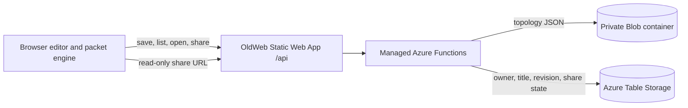

# Azure architecture for the browser network simulator

Status: proposed, 2026-10-12. No Azure resources have been created or changed.

## Decision

Keep the topology editor and deterministic packet engine in browser JavaScript. Store user-created topology **documents** in Azure; keep application source code in Git. Start cloud save/share on the site's existing Azure Static Web Apps managed API, with private Blob Storage for versioned topology JSON and Azure Table Storage for small metadata records. Use backend-held storage credentials in Static Web Apps application settings. Revisit a separate Function App with managed identity when cloud usage or access requirements justify the Standard plan and separate deployment.

This is a staged choice, not a claim that the current subscription, tier, or storage resources have been verified. Local `az` exists, but `az account show` could not complete in this sandbox because it tried to write a session file outside the workspace. No Azure MCP resource-management tools were exposed in this session.

## Flow

The website already deploys through `.github/workflows/azure-static-web-apps.yml` with `api_location: api`, Node 22 managed Functions, and staged `nettools/` assets. Its existing feedback Function stays intact. This architecture requires no source-code database and no direct browser credentials for Blob Storage.

## Data and API contract

- **Topology document:** schema version, bounded device and link arrays, coordinates, port assignments, IP configuration, simulator version, and title. Use JSON schema validation on every write and read. Reject unknown executable content and cap payload size well below the platform limit (initial target: 256 KiB and 200 devices; revise from measured use).
- **Blob path:** opaque topology ID plus immutable revision (for example `topologies/{id}/{revision}.json`). Private container; JSON content type; no public container access. Publishing a new revision should not silently change an existing shared snapshot.
- **Metadata:** topology ID, owner principal ID, title, created/updated timestamps, current revision/ETag, visibility, optional share-token hash, and deletion state. Keep a separate owner index for "My topologies" and a share lookup record if needed. Avoid Cosmos DB until queries or collaboration exceed Table Storage's simple key access.
- **API:** `POST /api/topologies` creates; `GET /api/topologies` lists the signed-in owner's items; `GET /api/topologies/{id}` reads; `PUT /api/topologies/{id}` saves with `If-Match`/revision check; `DELETE /api/topologies/{id}` soft deletes; `POST /api/topologies/{id}/shares` creates a read-only share; `DELETE /api/topologies/{id}/shares/{shareId}` revokes; `GET /api/shared/{shareId}` reads a published snapshot. Define exact routes to fit Azure Functions routing before implementation.
- **Concurrency:** require a matching revision/ETag on updates and return a conflict with recovery options when another save wins. Blob conditional headers support this pattern.

## Identity and sharing

- Guest editing stays local. Sign-in is required for cloud save/list/delete. Start with Static Web Apps' built-in GitHub or Microsoft Entra sign-in; accept provider + stable principal ID as the owner key, then verify ownership inside every API operation. Built-in Entra sign-in may admit users from outside a specific tenant, so a sign-in alone is not authorization to another person's document.
- Sharing is explicit and read-only. Generate an unpredictable token, store only its hash, return a link to a snapshot, and allow the owner to revoke it. Treat possession of the link as read permission; show that clearly in the UI. An opened shared topology can be copied into the viewer's own workspace for editing.
- Never expose storage account keys, connection strings, or unbounded SAS tokens in browser code. For small JSON, proxy uploads/downloads through the API. If direct Blob transfer is needed later, use short-lived, blob-scoped user-delegation SAS issued by a managed-identity backend.
- Validate content, ownership, size, link count, and port references server-side. Apply rate limits and quotas before anonymous creation or public sharing. Do not render user text as HTML.

## Platform choice and tradeoffs

| Path | Benefit | Cost / constraint | Use |
| --- | --- | --- | --- |
| Existing managed SWA Functions + private Blob/Table | Reuses current pipeline, `/api`, and PR previews; smallest operational change | No API managed identity or Key Vault references; backend storage credential in app settings | Recommended first cloud slice |
| SWA Standard + linked Function App + managed identity | Keyless Azure Storage RBAC, independent API scaling and operations | Separate Function deployment and bill; linked backend unavailable in SWA PR preview environments; `api_location` must become empty | Migration target when needed |

The linked Function App must keep its Azure App Service authentication link intact so its direct hostname does not become an anonymous bypass. Its deployment and staging tests need their own workflow.

## Cost, recovery, and operations

- Measure actual topology JSON size and save frequency before choosing a storage tier. Hot Blob is the practical initial tier for frequently reopened small files; set lifecycle rules for old revisions and deleted data. Enable Blob versioning/soft delete for recovery, with retention and lifecycle expiry to bound storage growth.
- Track API requests, failures, latency, Blob bytes/operations, Table transactions, and storage spend. Configure a budget alert before public cloud save. Do not put topology contents or share tokens in telemetry.
- Update the Network Tools copy and privacy page before launch. They currently say no accounts and that tool inputs remain in the browser; the simulator will be an explicit exception with clear save/share and deletion behavior.
- Keep the network engine usable when the save API is unavailable; show unsaved state and let users retry. Browser-local draft storage can be a convenience, but Azure is the system of record for saved designs.

## Delivery sequence

1. Finish client topology schema, editor, and deterministic simulation; add validation and local drafts.
2. Build a storage adapter and API tests against a local/fake provider. Prove create/read/update conflict/delete/share/revoke and malformed input behavior.
3. Provision a dedicated private Blob container and Table Storage, configure backend credentials, budget, telemetry, and recovery. Keep simulator data separate from existing MCP infrastructure.
4. Add sign-in and cloud save UI; verify ownership and share behavior in a preview/staging environment, then browser-test end to end.
5. Review usage and security needs. If moving to a linked Function App, upgrade SWA to Standard, add managed identity and RBAC, migrate the feedback endpoint too, and replace PR API previews with an explicit test environment.

## Facts to verify before provisioning

Current Static Web Apps plan and region; subscription budget and existing storage accounts; preferred sign-in provider; expected public/guest sharing policy; retention/deletion expectations; topology size and expected traffic. None of these require blocking client-side simulator work.

## Sources

- [SWA API integration choices](https://learn.microsoft.com/en-us/azure/static-web-apps/apis-functions)
- [SWA FAQ: managed identity limits](https://learn.microsoft.com/en-us/azure/static-web-apps/faq)
- [Bring your own Functions restrictions](https://learn.microsoft.com/en-us/azure/static-web-apps/functions-bring-your-own)
- [SWA authentication and authorization](https://learn.microsoft.com/en-us/azure/static-web-apps/authentication-authorization)
- [Blob Storage security recommendations](https://learn.microsoft.com/en-us/azure/storage/blobs/security-recommendations)
- [Blob conditional request headers](https://learn.microsoft.com/en-us/rest/api/storageservices/specifying-conditional-headers-for-blob-service-operations)
- [Blob soft delete and versioning](https://learn.microsoft.com/en-us/azure/storage/blobs/soft-delete-blob-overview)
- [SWA quotas](https://learn.microsoft.com/en-us/azure/static-web-apps/quotas)
